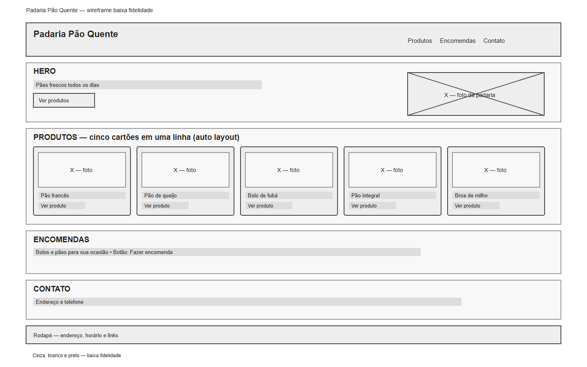

# Protótipos — Padaria Pão Quente

Os protótipos ficam nesta pasta `docs`, junto do `index.html`, como orienta a Aula 3. O HTML desta aula continua igual ao da Aula 2.

- [01-padaria.svg](./figma-imports/01-padaria.svg)

- [wireframe-desktop.svg](./wireframe-desktop.svg)
