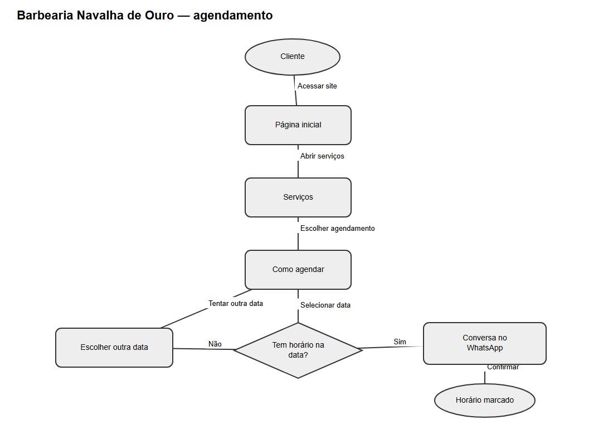

# Protótipos — Barbearia Navalha de Ouro

Os protótipos ficam nesta pasta `docs`, junto do `index.html`, como orienta a Aula 3. O HTML desta aula continua igual ao da Aula 2.

[Abrir o diagrama no diagrams.net](https://app.diagrams.net/?offline=1#R3ZhNb6MwEIZ%2FDdcqQL56bLPp9rLdlbJSz449wVYNg4zztb9%2BBzAkrGm3UiuUNJfg1zPYfhh7BoJ4kR42SkMQjSQWNoi%2FBVHE8vxGKJYYlhY3GViSqN8ec6j7BewUh1KNl0G8cKZkkrHUmdwzswZmFCP1ie2YluWVKMf5uTVIf8EyCuaj4HZM1yyBTJBvZrG9a3r4blguf6AAXboe6huH4WhUz0cca2XeCIlRwhmdhJX646YUNmZbJaDoGFpEbVXeFTlmGXDb0ZgxuO%2BabVB3R81pNZ6w4kz76rMSVv67rrLjEVQibWd9FRSDaBs8C9AlmGbNtffDK73toIYgv8eB1Q705LZu3gutyBdqvbDHZj3kR%2Biocb%2BXysIqZ7zs2dPTI03aVFMrpEuKM71Ajabyi6H6kV5Ygy9w1lP%2FqMfNAYyFw6vrCM9DBjAFa45k4hzGY4fVRcvMNfdn6BtNnlGfTtwTd087ae98gkYXjls%2Fw7XH8FewiIO7MFFZuR1Uprhi2iNqcJsJEA7bNVANb3uw3vZgbVB%2FBCv3sK7A7FSFdobFF8AZRwPiFP5OxxTbU9l8AZ7jyYA8weP5G9Iqv5p69xuFVa4scxizLIgffMQS0%2FW2uFS8URfvZO7jjeIevG2O%2BwjfTU%2B8ZrSeogSalWifJbPFXZ5fYeTOpu9AG%2FVF7ifkq8Qj%2B9iN2ZQZzgReWQkwm3eZTvuS1byvBviEaJUe02XBUUugc3WEW2vaY%2BD6grXdzk2w9oBty%2B5PP2ZDj%2Bwdh6IoE9aoUH2FqqA63DXRWIkJZkwvT%2Br9Cfmoi5cS4V1Z%2BlNzrZG%2F1NKD0o1BPVg5wtssaUK4NRw6RbZlJgF7VjP6xA1oZtWue%2FcP4Yt8fGujKnhvVlOXR3HtU%2BRDUYzf2t7%2FvNZeOEbuYxRDYRz3lPQauCIm5rXz8fIICp8gDEVw4hNU6RUwA5%2FZZihm075KcqNM2vPSc3nkNj65ZChyM4%2FcU5UwYrzOkJNDgZv3vBxmlv23GLw8inKwdEHN03fPqu%2Fsy3AjNh%2BhT0bVZ%2B14%2BRc%3D)

- [fluxo.drawio](./fluxo.drawio)

- [fluxo.svg](./fluxo.svg)
