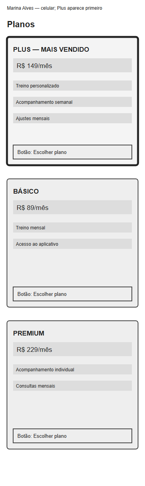
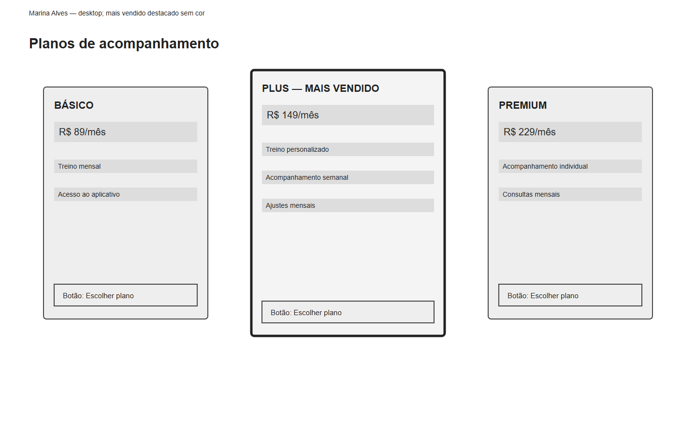
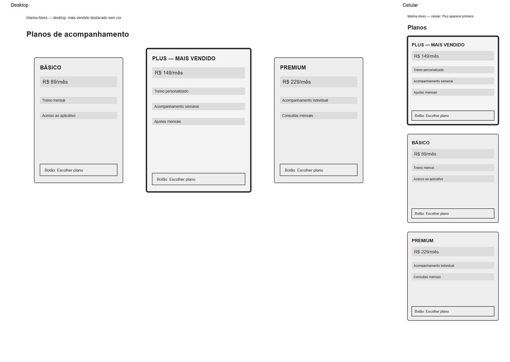

# Protótipos — Personal Marina Alves

Os protótipos ficam nesta pasta `docs`, junto do `index.html`, como orienta a Aula 3. O HTML desta aula continua igual ao da Aula 2.

- [08-personal-fixed.svg](./figma-imports/08-personal-fixed.svg)

- [08-personal.svg](./figma-imports/08-personal.svg)

- [planos-celular.svg](./planos-celular.svg)

- [planos-desktop.svg](./planos-desktop.svg)

- [planos-wireframe.svg](./planos-wireframe.svg)
