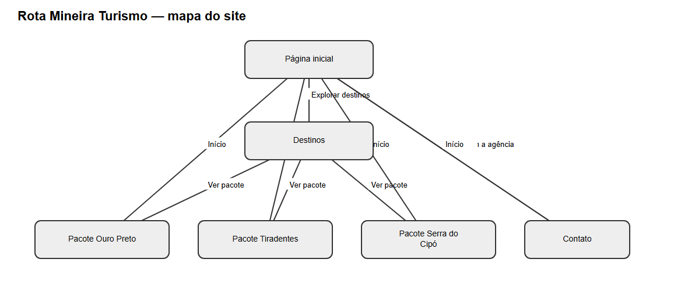

# Protótipos — Agência Rota Mineira Turismo

Os protótipos ficam nesta pasta `docs`, junto do `index.html`, como orienta a Aula 3. O HTML desta aula continua igual ao da Aula 2.

[Abrir o diagrama no diagrams.net](https://app.diagrams.net/?offline=1#R3ZhNc9sgEIZ%2Fja4ZSzhfx0R22h4yzdSZ9kxhIzFBrAatY7u%2FviAhy6ritjNt5So6wbvLxz6sgCFiabF9UhqiZJZjRRFbREnCy%2FJMKp5ZXlRnBshJzk67Ehq7hBclwKtsGbE0uDoXw4vg8gmJO%2BFeGVDWlx7XVlUFulK0TKKrWXQ9d%2BWCl94ovV4p6vostu8sL%2FN7lKC9w7bpNo5dy3o2ctco50kQMqtkcOqElfoWJhS3bmsloeo5EqImVfZFgcaAoJ7GrcVN3%2B0JdX%2FUkmcwEFaC66H6RUnKf4zLG96DynLqxVdDsYjU4klBezBtzE3ruyPW%2FaAWDP1OA9U0eOF6Heb9EKUsuokzZfyCKaOE4rrxqmjXRmdxbST4TuKI3W5yt6Srkgtv3bj1dFpOhQ5ml3c6RY22bsug%2FpxekcVnOLA0n7OEWYEl2B6NLD5MIsACyO6cS2gwb%2FMl5M9lqG66xWjhzPKDdbg4DzkQ1j%2Fb99xhdIVA8nWqckB1ARUpg9UbALn%2Fw8YgicP85AL9%2FjH7uLZ%2BN3mwQDhBrBd9quzqFarsH1Gl41Qf3S4uXQgwxVRl8xNCrY5DXYG1%2B%2BMvVaXfYm%2FZFJM2OSFgMQCcoiE%2Byb%2F%2FevZrkPurwt8GCfGA5HJbuji59Ul67KgC6S44oYqWcszQcL3s1NuO%2B6zPGIy88XcqV%2F2qUTw30p3SrUMzmB%2Fh50DdhHBtBfRuL8RtBnRw9A6xW9Cc1Eu%2F9z9imAwY3nFdAxTor8j%2Bf%2BdZfZm6Me4ONU2cYiycbIDzM9h6ys0e%2Bt%2FDk0N4OBa8%2BRuER2PBO3%2BD8Kqx4F0M4H0w9Z63EAonwA6H7NRY7C4nzo5OyO5q4uyqE7K7njg7MRo7V%2B2e4mrbwWNlK7avop1T%2Fc7Klt8B)

- [mapa-site.drawio](./mapa-site.drawio)

- [mapa-site.svg](./mapa-site.svg)
