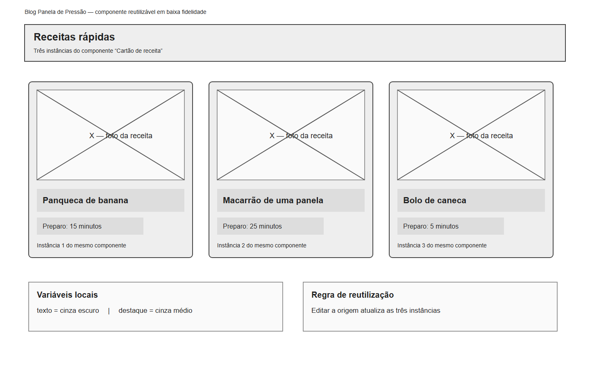

# Protótipos — Blog Panela de Pressão

Os protótipos ficam nesta pasta `docs`, junto do `index.html`, como orienta a Aula 3. O HTML desta aula continua igual ao da Aula 2.

- [componente-cartao-receita.svg](./componente-cartao-receita.svg)

- [04-blog-receitas.svg](./figma-imports/04-blog-receitas.svg)

- [para-que-serve.txt](./para-que-serve.txt)
