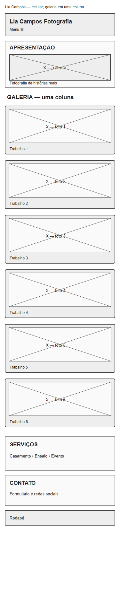
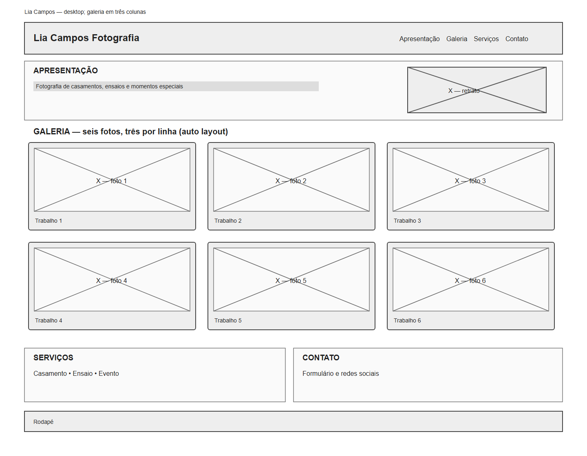
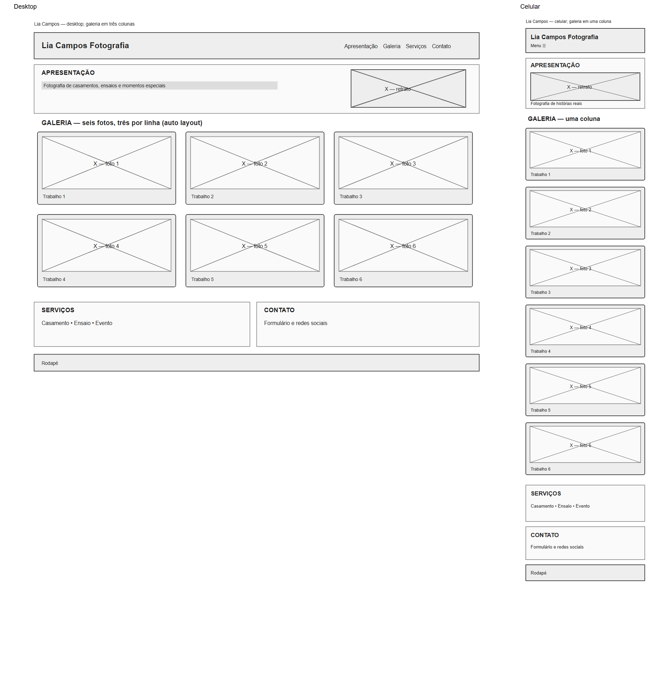

# Protótipos — Portfólio de Lia Campos

Os protótipos ficam nesta pasta `docs`, junto do `index.html`, como orienta a Aula 3. O HTML desta aula continua igual ao da Aula 2.

- [06-portfolio-fotografa-fixed.svg](./figma-imports/06-portfolio-fotografa-fixed.svg)

- [06-portfolio-fotografa.svg](./figma-imports/06-portfolio-fotografa.svg)

- [wireframe-celular.svg](./wireframe-celular.svg)

- [wireframe-desktop.svg](./wireframe-desktop.svg)

- [wireframes-desktop-celular.svg](./wireframes-desktop-celular.svg)
